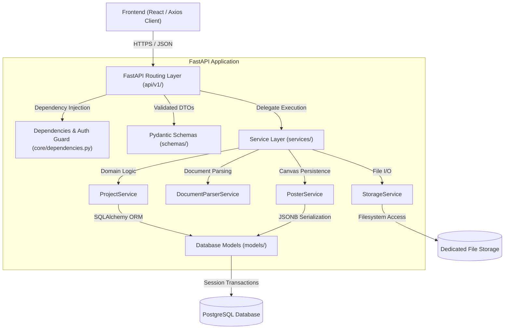

# Infographix — Backend Architecture Design

**Framework:** FastAPI 0.143+ (Python 3.12)  
**Database:** PostgreSQL 16+ via SQLAlchemy 2.0 ORM  
**Architecture Pattern:** Layered Domain-Driven Modular Monolith

---

## 1. System Overview

The Infographix backend is structured as a decoupled, layered application with strict separation between HTTP transport, domain business logic, data persistence, and file storage.

### Core Architectural Principles:
1. **Separation of Concerns**: Route handlers (`api/v1/`) only validate inputs, call services, and return responses. Business logic lives exclusively in `services/`.
2. **Schema-First Contracts**: Every request and response payload is validated through strictly typed Pydantic v2 models that match the frontend TypeScript types.
3. **Pluggable Storage Layer**: File operations are abstracted behind a `StorageService` interface, allowing seamless transition from local disk storage in development to S3/GCS in production without changing application code.
4. **Isolated ML Extension Hook**: Future ML pipelines (e.g. `ModelRegistry` layout prediction) plug into `services/layout_service.py` without modifying the core project persistence or canvas editing pipeline.

---

## 2. Directory Layout

```text
backend/
├── app/
│   ├── __init__.py
│   ├── main.py                     # Application factory, CORS, exception handlers
│   │
│   ├── core/                       # Cross-cutting foundational modules
│   │   ├── __init__.py
│   │   ├── config.py               # Pydantic Settings (ENV, paths, JWT keys)
│   │   ├── security.py             # Bcrypt hashing, JWT encoding/decoding
│   │   └── dependencies.py         # DB session & get_current_user dependencies
│   │
│   ├── api/                        # HTTP Routing Layer (v1)
│   │   ├── __init__.py
│   │   └── v1/
│   │       ├── __init__.py
│   │       ├── router.py           # Aggregated v1 APIRouter
│   │       ├── auth.py             # User login, registration, me
│   │       ├── projects.py         # Project CRUD, rename, duplicate, status
│   │       ├── documents.py        # PDF/DOCX multipart upload & download
│   │       ├── extraction.py       # Deterministic extraction & section saves
│   │       ├── posters.py          # Canvas document persistence & autosave
│   │       ├── assets.py           # Image uploads & media streaming
│   │       ├── submissions.py      # Project submission records
│   │       └── health.py           # System status & DB connectivity
│   │
│   ├── db/                         # Database Configuration & Sessions
│   │   ├── __init__.py
│   │   ├── base.py                 # SQLAlchemy DeclarativeBase
│   │   └── session.py              # Engine factory, sessionmaker, scoped sessions
│   │
│   ├── models/                     # SQLAlchemy Relational & JSONB Models
│   │   ├── __init__.py
│   │   ├── user.py                 # User table
│   │   ├── project.py              # Project table
│   │   ├── section.py              # ResearchSection table
│   │   ├── document.py             # UploadedDocument table
│   │   ├── poster.py               # PosterDocument table (JSONB elements)
│   │   ├── asset.py                # Asset table
│   │   └── submission.py           # Submission table
│   │
│   ├── schemas/                    # Pydantic Validation & Serialization Models
│   │   ├── __init__.py
│   │   ├── auth.py                 # Login, Register, Token schemas
│   │   ├── project.py              # ProjectCreate, ProjectUpdate, ProjectOut
│   │   ├── section.py              # ResearchSection schema
│   │   ├── document.py             # DocumentMetadata, UploadResponse
│   │   ├── poster.py               # PosterDocument, PosterElement schemas
│   │   ├── asset.py                # AssetUploadOut, AssetMeta
│   │   └── submission.py           # SubmissionOut
│   │
│   └── services/                   # Business Logic & Infrastructure Services
│       ├── __init__.py
│       ├── auth_service.py         # Registration & credential validation
│       ├── project_service.py      # Project lifecycle & cloning logic
│       ├── document_parser.py      # PyMuPDF / python-docx extraction engine
│       ├── poster_service.py       # Canvas JSON serialization & validation
│       ├── asset_service.py        # Media validation & image handling
│       └── storage_service.py      # Local filesystem manager (safe paths)
│
├── migrations/                     # Alembic Migration Scripts
│   ├── env.py
│   ├── script.py.mako
│   └── versions/
│
├── tests/                          # Pytest Suite
│   ├── conftest.py                 # Test database fixtures, client mock
│   ├── test_auth.py
│   ├── test_projects.py
│   ├── test_documents.py
│   ├── test_posters.py
│   └── test_integration.py
│
├── data/                           # Local File Storage (Mountable Volume)
│   └── uploads/
│       ├── documents/              # Stored research papers (.pdf, .docx)
│       ├── assets/                 # Stored images (.png, .jpg, .svg)
│       └── extracted/              # Extracted figures and tables
│
├── requirements.txt
├── .env.example
├── Dockerfile
└── README.md
```

---

## 3. Core Architectural Layers



---

## 4. Security & Middleware Configuration

1. **CORS Middleware**:
   * Configured for the Vite development server (`http://localhost:5173`, `http://localhost:3000`) and production deployment domains.
   * `allow_credentials=True`, `allow_methods=["*"]`, `allow_headers=["*"]`.
2. **JWT Authentication & Passwords**:
   * Passwords hashed with `passlib[bcrypt]` / `bcrypt` using auto-generated work factor.
   * Stateless JWT Bearer access tokens signed with HMAC-SHA256 (`HS256`).
   * Configurable token expiration (default 60 minutes) managed via `core/config.py`.
3. **Storage Security & Path Traversal Prevention**:
   * All files stored using UUID filenames (e.g. `c73a218c-3094.pdf`), stripping user-submitted path names.
   * File access verified against project ownership before streaming bytes.

