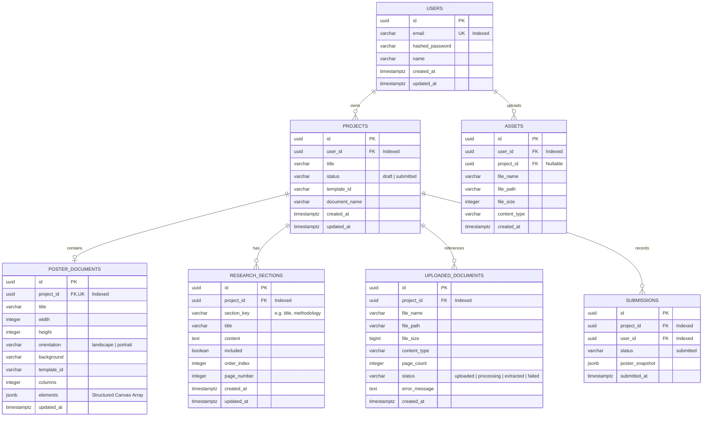

# Infographix — PostgreSQL Database Architecture Design

**Database Engine:** PostgreSQL 16+  
**ORM Framework:** SQLAlchemy 2.0 (with async/sync session management)  
**Schema Migration Engine:** Alembic  
**Target Architecture:** Hybrid Relational Core + JSONB Document Canvas

---

## 1. Architectural Rationale & Design Strategy

The database schema reflects a pragmatic hybrid architecture:
1. **Relational Tables** (`users`, `projects`, `uploaded_documents`, `research_sections`, `assets`, `submissions`):
   * Manage users, permissions, document metadata, and discrete entities where relational foreign keys, indexing, and transactional integrity are vital.
   * Provide strict user data isolation: all projects, documents, and assets cascade from `users.id`.
2. **PostgreSQL `JSONB` Storage** (`poster_documents.elements`):
   * Canvas elements in the frontend editor (`PosterElement[]`) contain over 35 heterogeneous properties (`points`, `lineHeight`, `fontStyle`, `imageFit`, `layer`, `locked`, `rotation`, `align`).
   * Normalizing elements into a separate `poster_elements` relational table would require deleting and re-inserting dozens of rows every 1,200 ms during editor autosave.
   * Storing canvas elements inside a PostgreSQL `JSONB` column guarantees microsecond persistence times, zero schema coupling when new Konva shapes or styling options are added, and 100% element order and floating-point coordinate preservation.

---

## 2. Entity Relationship Diagram

---

## 3. Table Schema Specifications

### 3.1 `users`
Represents registered platform accounts.
* `id` (`UUID`, Primary Key, default `gen_random_uuid()`): Unique user ID.
* `email` (`VARCHAR(255)`, Unique, Not Null, Indexed): Account email address.
* `hashed_password` (`VARCHAR(255)`, Not Null): Bcrypt/Argon2 password hash.
* `name` (`VARCHAR(100)`, Not Null): User full name.
* `created_at` (`TIMESTAMPTZ`, Not Null, default `clock_timestamp()`): Creation timestamp.
* `updated_at` (`TIMESTAMPTZ`, Not Null, default `clock_timestamp()`): Modification timestamp.

### 3.2 `projects`
Represents an individual poster creation workspace.
* `id` (`UUID`, Primary Key, default `gen_random_uuid()`): Matches frontend project UUID.
* `user_id` (`UUID`, Foreign Key -> `users.id` ON DELETE CASCADE, Indexed): Owner of the project.
* `title` (`VARCHAR(255)`, Not Null, default `'Untitled research poster'`): Project title.
* `status` (`VARCHAR(20)`, Not Null, default `'draft'`): Current status (`'draft'`, `'submitted'`).
* `template_id` (`VARCHAR(50)`, Not Null, default `'research'`): Selected template identifier.
* `document_name` (`VARCHAR(255)`, Nullable): Display name of the attached research paper.
* `created_at` (`TIMESTAMPTZ`, Not Null, default `clock_timestamp()`).
* `updated_at` (`TIMESTAMPTZ`, Not Null, default `clock_timestamp()`).

### 3.3 `poster_documents`
Represents the editable canvas stage and element graph.
* `id` (`UUID`, Primary Key, default `gen_random_uuid()`): Poster document ID.
* `project_id` (`UUID`, Foreign Key -> `projects.id` ON DELETE CASCADE, Unique, Indexed): 1-to-1 project relation.
* `title` (`VARCHAR(255)`, Not Null): Canvas title.
* `width` (`INTEGER`, Not Null, default `1000`): Canvas width in pixels.
* `height` (`INTEGER`, Not Null, default `700`): Canvas height in pixels.
* `orientation` (`VARCHAR(20)`, Not Null, default `'landscape'`): `'portrait'` or `'landscape'`.
* `background` (`VARCHAR(50)`, Not Null, default `'#ffffff'`): Background color code.
* `template_id` (`VARCHAR(50)`, Not Null, default `'research'`): Associated template ID.
* `columns` (`INTEGER`, Not Null, default `3`): Column count.
* `elements` (`JSONB`, Not Null, default `'[]'::jsonb`): Complete array of `PosterElement` objects.
* `updated_at` (`TIMESTAMPTZ`, Not Null, default `clock_timestamp()`).

### 3.4 `research_sections`
Stores discrete extracted research sections for review.
* `id` (`UUID`, Primary Key, default `gen_random_uuid()`).
* `project_id` (`UUID`, Foreign Key -> `projects.id` ON DELETE CASCADE, Indexed).
* `section_key` (`VARCHAR(50)`, Not Null): Canonical section key (e.g., `'title'`, `'abstract'`, `'methodology'`).
* `title` (`VARCHAR(150)`, Not Null): Display title.
* `content` (`TEXT`, Not Null, default `''`): Body text.
* `included` (`BOOLEAN`, Not Null, default `true`): Included in poster toggle.
* `order_index` (`INTEGER`, Not Null, default `0`): UI display ordering.
* `page_number` (`INTEGER`, Nullable): Source paper page reference.
* `created_at` (`TIMESTAMPTZ`, Not Null, default `clock_timestamp()`).
* `updated_at` (`TIMESTAMPTZ`, Not Null, default `clock_timestamp()`).

### 3.5 `uploaded_documents`
Tracks binary PDF/DOCX files uploaded by users.
* `id` (`UUID`, Primary Key, default `gen_random_uuid()`).
* `project_id` (`UUID`, Foreign Key -> `projects.id` ON DELETE CASCADE, Indexed).
* `file_name` (`VARCHAR(255)`, Not Null): Original filename uploaded.
* `file_path` (`VARCHAR(500)`, Not Null): Sanitized internal filesystem path under `backend/data/uploads/documents/`.
* `file_size` (`BIGINT`, Not Null): Size in bytes (max 20 MB).
* `content_type` (`VARCHAR(100)`, Not Null): Validated MIME type (`application/pdf`, etc.).
* `page_count` (`INTEGER`, Nullable): Detected number of pages.
* `status` (`VARCHAR(30)`, Not Null, default `'uploaded'`): Extraction state (`'uploaded'`, `'processing'`, `'extracted'`, `'failed'`).
* `error_message` (`TEXT`, Nullable): Extraction error log if failed.
* `created_at` (`TIMESTAMPTZ`, Not Null, default `clock_timestamp()`).

### 3.6 `assets`
Tracks media files uploaded for poster canvas inclusion.
* `id` (`UUID`, Primary Key, default `gen_random_uuid()`).
* `user_id` (`UUID`, Foreign Key -> `users.id` ON DELETE CASCADE, Indexed).
* `project_id` (`UUID`, Foreign Key -> `projects.id` ON DELETE SET NULL, Nullable).
* `file_name` (`VARCHAR(255)`, Not Null).
* `file_path` (`VARCHAR(500)`, Not Null): Internal path under `backend/data/uploads/assets/`.
* `file_size` (`INTEGER`, Not Null).
* `content_type` (`VARCHAR(50)`, Not Null): Image MIME type.
* `created_at` (`TIMESTAMPTZ`, Not Null, default `clock_timestamp()`).

### 3.7 `submissions`
Tracks finalized project submissions.
* `id` (`UUID`, Primary Key, default `gen_random_uuid()`).
* `project_id` (`UUID`, Foreign Key -> `projects.id` ON DELETE CASCADE, Indexed).
* `user_id` (`UUID`, Foreign Key -> `users.id` ON DELETE CASCADE, Indexed).
* `status` (`VARCHAR(30)`, Not Null, default `'submitted'`).
* `poster_snapshot` (`JSONB`, Nullable): Immutable frozen snapshot of the poster state at submission time.
* `submitted_at` (`TIMESTAMPTZ`, Not Null, default `clock_timestamp()`).

---

## 4. Indexing & Performance Strategy
* **Foreign Keys**: Every foreign key (`project_id`, `user_id`) is explicitly indexed to guarantee sub-millisecond query filtering.
* **GIN Index on Canvas Elements**: `CREATE INDEX idx_poster_elements_gin ON poster_documents USING gin (elements);` enables efficient querying if element attribute filtering is required in the future.
* **Cascading Deletions**: Deleting a project automatically and cleanly purges its associated sections, documents, poster, and submissions without orphan data.

---

## 5. Alembic Migration Strategy
* Migrations directory will reside in `backend/migrations/`.
* Version-controlled migration scripts:
  * `0001_initial_schema.py`: Creates `users`, `projects`, `uploaded_documents`, `research_sections`, `poster_documents`, `assets`, `submissions`.
* Managed via `alembic upgrade head` in development and container entrypoint scripts in production.

