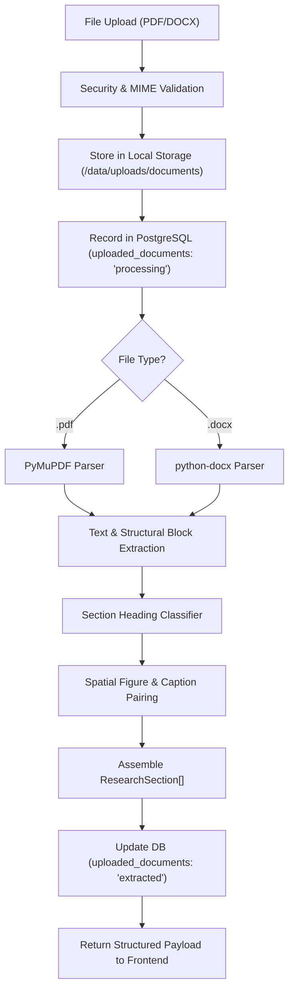

# Infographix — Document Processing Pipeline Design

**Architecture:** Deterministic Hybrid Document Parsing  
**Core Libraries:** PyMuPDF (`fitz`), `python-docx`, `pdfplumber` (tables), `Tesseract OCR` (scanned fallback)  
**Primary Goal:** Fast, reliable, hallucination-free research content and structure extraction preserving source page references.

---

## 1. Architectural Principles

1. **Deterministic Accuracy**: The initial extraction pipeline must never hallucinate, invent, or silently summarize technical facts. What is extracted must reflect the exact textual content of the user's paper.
2. **Page Reference Tracking**: Every extracted section preserves its source `pageNumber` so researchers can verify source veracity during the **Review** step.
3. **Graceful Degradation**: If specific headings (e.g. "Problem Statement" or "Objectives") are not explicitly titled in a 4-page conference paper, the parser extracts the available headings and provides empty or fallback placeholder blocks rather than failing.
4. **Decoupled Architecture**: Extraction is implemented as a standalone service (`DocumentParserService`) that can easily be augmented with NLP summarization or LLMs in later AI/ML phases without breaking the data contract.

---

## 2. Ingestion & Validation Workflow



---

## 3. Extraction Engines

### 3.1 PDF Parser (PyMuPDF / `fitz`)
* **Efficiency**: PyMuPDF is implemented in C++ (MuPDF engine) and processes a 10-page academic paper in under 120 ms.
* **Block Extraction**: Uses `page.get_text("blocks")` which returns:
  `[x0, y0, x1, y1, text, block_no, block_type]`
* **Heading Identification Heuristics**:
  1. **Font Size & Weight**: Headings have font sizes larger than the modal body font size (e.g., 14pt+ vs 10pt).
  2. **Regex Pattern Matching**:
     ```python
     SECTION_PATTERNS = {
         "title": r"^(title|paper\s+title)",
         "abstract": r"^(abstract)",
         "introduction": r"^(1[\.\s]+)?introduction",
         "problem": r"^(problem\s+statement|problem\s+formulation)",
         "objectives": r"^(objectives|contributions|research\s+goals)",
         "methodology": r"^([2-4][\.\s]+)?(methodology|methods|proposed\s+approach|architecture|system\s+design)",
         "results": r"^([3-5][\.\s]+)?(results|experiments|experimental\s+results|evaluations)",
         "discussion": r"^([4-6][\.\s]+)?(discussion|analysis)",
         "conclusion": r"^([5-7][\.\s]+)?(conclusion|concluding\s+remarks)",
         "references": r"^(references|bibliography)",
         "keywords": r"^(keywords|index\s+terms)",
     }
     ```
  3. **Metadata Extraction**: Extracts PDF metadata (`doc.metadata["title"]`, `doc.metadata["author"]`) as an initial hint for title and authors.

### 3.2 DOCX Parser (`python-docx`)
* Inspects `doc.paragraphs` and paragraph styles (`Heading 1`, `Heading 2`, `Title`).
* Preserves paragraph groupings and bold text runs for heading identification.

### 3.3 Scanned Document Detection & Fallback
* If `doc[0].get_text().strip()` yields fewer than 40 characters across multiple pages, the document is flagged as a rasterized/scanned PDF.
* Pipeline flags `uploaded_documents.status = 'scanned'` and invokes OCR (`pytesseract`) if configured, or alerts the user in the UI.

---

## 4. Figure & Table Extraction

1. **Figure Extraction**:
   * PyMuPDF iterates `doc.get_page_images(page_idx)` to extract embedded PNG/JPEG raster figures.
   * Extracted figures are stored under `backend/data/uploads/extracted/figures/{document_id}_{img_idx}.png`.
2. **Spatial Caption Pairing**:
   * Uses bounding-box spatial proximity to pair detected figures with caption blocks starting with `"Figure [0-9]+:"` or `"Fig. [0-9]+:"` located immediately below or above the figure.

---

## 5. Output Data Contract

The pipeline returns a clean list of `ResearchSection` objects directly matching the frontend contract:

```json
[
  { "id": "title", "title": "Title", "content": "Deep Learning for Scientific Layouts", "included": true, "pageNumber": 1 },
  { "id": "authors", "title": "Authors", "content": "A. Researcher, B. Scientist", "included": true, "pageNumber": 1 },
  { "id": "affiliations", "title": "Affiliations", "content": "Department of Computer Science, University of Technology", "included": true, "pageNumber": 1 },
  { "id": "abstract", "title": "Abstract", "content": "Scientific posters require structured layout...", "included": true, "pageNumber": 1 },
  { "id": "introduction", "title": "Introduction", "content": "Academic communication has evolved...", "included": true, "pageNumber": 1 },
  { "id": "problem", "title": "Problem statement", "content": "Manual layout design is time-consuming...", "included": true, "pageNumber": 2 },
  { "id": "objectives", "title": "Objectives", "content": "1. Automate section extraction. 2. Preserve visual hierarchy.", "included": true, "pageNumber": 2 },
  { "id": "methodology", "title": "Methodology", "content": "We employ 2D spatial clustering...", "included": true, "pageNumber": 3 },
  { "id": "results", "title": "Results", "content": "Silhouette score reached 0.72...", "included": true, "pageNumber": 5 },
  { "id": "discussion", "title": "Discussion", "content": "The anisotropic weighting proved essential...", "included": true, "pageNumber": 6 },
  { "id": "conclusion", "title": "Conclusion", "content": "Infographix demonstrates robust poster generation.", "included": true, "pageNumber": 7 },
  { "id": "references", "title": "References", "content": "[1] Vaswani et al. Attention is all you need...", "included": true, "pageNumber": 8 },
  { "id": "keywords", "title": "Keywords", "content": "deep learning, scientific layout, posters", "included": true, "pageNumber": 1 }
]
```

